# GLM-5.3 at TP4 and TP8

The GLM plugin runs the 75 MoE layers in one launch per layer, with up to 16
query tokens per step at TP4. Dense layers, the final norm and logits use
SGLang's existing forward. Larger steps use the model fallback. TP8 retains
its eight-row range for both A8W8 and native A4W4.

The grouped/cohort schedules are adapted from [ROCm/FlyDSL#1256](https://github.com/ROCm/FlyDSL/pull/1256)
at `032072c9406475cde47cf2017506f7c2604d5cce`, using SGLang's request, weight and
paged-cache layouts.

## Weights and caches

| Loaded experts | MoE activations | Requirements |
| --- | --- | --- |
| Block-FP8 | FP8 (A8W8) | AITER shuffled weights, FP32 block-128 scales |
| Quark/AITER MXFP4 | FP4 (A4W4) | TP4/TP8, E2M1 weights and E8M0 scales, separated gate/up rows |

A4W4 reads `QuarkW4A4MXFp4MoE` storage in place: 256 routed experts and one
fused shared expert. The local intermediate width follows tensor parallelism:

| TP | Local intermediate | Gate/up bytes | Down bytes | Gate/up E8M0 scales | Down E8M0 scales |
| --- | ---: | --- | --- | --- | --- |
| 4 | 512 | `[257, 1024, 3072]` | `[257, 6144, 256]` | `[257, 1024, 192]` | `[257, 6144, 16]` |
| 8 | 256 | `[257, 512, 3072]` | `[257, 6144, 128]` | `[257, 512, 192]` | `[257, 6144, 8]` |

Attention and indexer projections still require the existing shuffled
block-FP8 format. The layer op checks MXFP4 tensor element counts against the
compiled TP shard before a launch.

The loader rejects ambiguous packed bytes, W4A8, GU-interleaved/SiTU storage,
missing scales and unshuffled weights. Loaded tensors determine the activation
format. An explicit `moe_activation_dtype="fp8"` or `"fp4"` forward argument must
match those tensors; forward does not convert weights.

MLA cache supports contiguous BF16 or SGLang's raw E4M3 HIP layout: 576 values
per physical slot. Scaled E4M3 rows from other DSA backends are incompatible.
The index cache remains shuffled paged FP8 with 64-token pages and one FP32
power-of-two scale per token. Cache dtype is chosen at build time from SGLang.
The wide schedule requires a full 256-CU MI355X.

## Widths and multi-token steps

At TP4, A8W8 uses buckets 2, 4, 6, 8, 12 and 16. A4W4 uses exact widths
1–12 and pads 13–16 logical rows to the 16-row cohort bucket. The direct native
TP4 builder accepts every physical width 1–16.

At TP8, both formats support up to eight total query rows. The serving spec
pads logical widths to buckets 2, 4 and 8, including one-row decode at physical
width two. Native A4W4 uses the generic schedule with eight local attention
heads and intermediate width 256; TP4 grouped/cohort schedules stay restricted
to TP4. MTP3 batch 1/2 × seq 4 uses the mono path. Batch 4 × seq 4 has sixteen
rows and uses the normal serving fallback.

Verify steps must contain one linear draft chain per request: EAGLE top-k 1
and draft tokens equal to draft steps plus one. Each query sees keys only
through its own causal position, retains its request's page table, and writes
its assigned physical slot. Padding writes no cache and attends no keys.
Auxiliary hidden-state capture uses the unpadded input before launch outputs
reuse the buffer.

## Multi-CTA top-k

Indexer scoring uses upstream [#42](https://github.com/sgl-project/sgl-amd-mono/pull/42)'s
wave scoring on every TP rank. Rows above 32K live keys use upstream
[#24](https://github.com/sgl-project/sgl-amd-mono/pull/24)'s multi-CTA
histogram/gather selector; shorter rows use a single-CTA selector.

The selector uses up to 16 CTA slices per row. Wide/cohort grids cap the slice
count to fit their resident upper half. The result is exact top-2048 in compact
physical-slot form, with the upstream threshold-tie and candidate ordering;
its output order is not a score sort. New keys are read from the complete
launch's mailboxes across row cohorts. Live lengths may cross the selector
threshold during graph replay.

Peer buffers must be closed collectively before destroying the process group.
All ranks finish unmapping before an exporter frees its storage. A failed close
retains ownership for collective retry; repeated successful closes are safe.

## Correctness checks

Run in the project's FlyDSL/AITER environment with four GPUs for TP4 or eight for TP8:

```bash
python -m pytest -q test/unit/test_glm53_spec.py test/unit/test_glm53_select.py \
  test/unit/test_peer.py

python -m pytest -q test/kernels/test_glm53_kernels.py::test_mxfp4_tp4
python -m pytest -q test/kernels/test_glm53_kernels.py::test_mxfp4_tp8
```

The TP4 parameterized GPU test covers 1×16, 2×8 and MTP3-shaped 1×4, 2×4,
4×4 steps. TP8 adds 1×4 and 2×4 with the same shared checks: independent
A4W4 MoE arithmetic and quantization codes/scales, serial/batched state,
expanded page tables, causality, cache preservation and replay. Its fixture,
independent arithmetic oracle and serial control are shared helpers. It uses
128K live contexts in all seq-4 arithmetic cases and 64-slot caches in the
expanded-page-table regression. It uses synthetic weights without a server
profile or checkpoint conversion. Full A4W4 checkpoint quality, multilayer
quality, MTP acceptance and serving
mono-kernel on/off results require serving validation.

## Optional performance measurements

The same unit test can time its independently validated A4W4 layer cases:

```bash
GLM53_PERF=1 python -m pytest -s -v \
  test/kernels/test_glm53_kernels.py::test_mxfp4_tp4
```

To also measure the current A8W8 path with the same shapes, capacities, seed
and timing method:

```bash
GLM53_PERF=1 GLM53_PERF_A8W8=1 python -m pytest -s -v \
  test/kernels/test_glm53_kernels.py::test_mxfp4_tp4
```

Select only the MTP3 matrix (batch 1/2/4, four verify rows per request):

```bash
GLM53_PERF=1 GLM53_PERF_A8W8=1 python -m pytest -s -v \
  test/kernels/test_glm53_kernels.py::test_mxfp4_tp4 \
  -k '1-4 or 2-4 or 4-4'
```

These shapes map to SGLang's EAGLE `num_steps=3`, `topk=1`,
`num_draft_tokens=4`. The unit test does not start SGLang or measure draft
generation/acceptance. All three MTP3 cases use 131072-slot caches with
live lengths near 128K, so the batch sizes have comparable contexts.

This optional comparison first checks A8W8's own causal serial/batched
control and then times its full indexed batched layer. The A4W4 and A8W8
helpers share timing/statistics in the existing `fixtures.py`. They use
their respective synthetic expert weights; no cross-precision numerical
equivalence or serving speedup is claimed.

Timing is disabled by default. `GLM53_PERF_SAMPLES` defaults to 100 and
`GLM53_PERF_WARMUP` to 20; at least 20 samples and one warmup are required.
`GLM53_PERF_KERNEL_REPLAYS` defaults to 20 and requires at least 20 replays.
The standalone `check_mxfp4.py` helper accepts `--perf`, `--perf-samples`,
`--perf-warmup` and `--perf-kernel-replays` for the same measurements.

Each `PERF_RESULT` JSON line reports median, P95, minimum, maximum and mean
in microseconds, individual samples, per-rank statistics and source hashes.
Each sample times one complete layer HIP graph replay including indexer,
attention, MoE and TP communication, then takes the maximum duration
across all ranks (four at TP4, eight at TP8). P95 is the nearest-rank percentile
of those maxima, not the maximum of rank-local P95 values or a percentile of
trial averages.

Initial caches are restored before each replay outside the HIP event interval.
Compilation, weight packing, cache copies and host barriers are excluded;
one weight allocation is reused. The existing numerical, cache and replay
checks must pass, and output/cache/guard checks are repeated after timing.
These are synthetic single-layer GPU latency distributions; they do not
measure serving TPOT or request P95. The 1×16 and 2×8 cases use 64-slot caches;
the three seq-4 cases use 131072-slot caches. Perf mode does not time the separate fixed-index
serial/batched page-table comparison.

Perf mode separately profiles 20 graph replays to report every GPU kernel
name, calls per replay, per-rank invocation median/P95 and total time per
replay. `kernel_breakdown` contains those statistics and raw event durations.
The recorder first primes ROCm graph tracing with one replay outside the
`glm53_measured_kernel_replays` range. Only device events wholly inside that
synchronized range are counted; all ranks must capture the complete 20
measured mono launches. Capture validation is collective so a local failure
does not leave peers gathering results while that rank enters runtime close.
Each profiled replay is device-synchronized and followed by a host barrier
before the next replay, matching the isolated-step scope of the ordinary
replay samples. The annotation itself is excluded from kernel statistics.
Each kernel's maximum rank mean total is reported for convenience; these
independently selected maxima must not be summed into overall replay P95.
Profiler timing is distinct from the uninstrumented replay distribution.
Fused attention/indexer/MoE stages appear as one `glm5_monokernel` event;
the epoch update appears as its own kernel. No internal stage duration is
inferred from that fused event.

## TP8 MTP3 unit checks

The existing GPU script covers TP8 A4W4 and the original A8W8 verify widths:

```bash
GLM53_PERF=1 GLM53_PERF_A8W8=1 HIP_VISIBLE_DEVICES=0,1,2,3,4,5,6,7 \
  python -m pytest -s -v test/kernels/test_glm53_kernels.py::test_mxfp4_tp8

# A8W8 alone
GLM53_PERF=1 HIP_VISIBLE_DEVICES=0,1,2,3,4,5,6,7 python -m pytest -s -v \
  test/kernels/test_glm53_kernels.py::test_a8w8_tp8
```

This runs batch 1 and 2 with four query tokens each, the same 131072-slot
caches, seed 821, serial controls and replay/kernel statistics as TP4.
Local synthetic weight shapes change with TP; these are not partitions of
one shared real checkpoint across TP4 and TP8.
`GLM53_PERF=0` runs correctness only. Batch 4 × seq 4 is 16 rows and exceeds
the TP8 serving mono limit of eight rows; serving uses the normal fallback
for that shape. Native A4W4 supports TP8 within the same eight-row limit.

TP8 matches the original E2E's tensor parallelism and MTP3 verify widths.
These remain synthetic single-layer checks: the E2E uses a real GLM-5.3
checkpoint, prompt-dependent contexts, multilayer serving and acceptance
checks. Its 131072 chunked-prefill setting is not a fixed context length,
and its script does not report comparable single-layer replay median/P95.

During perf-harness validation, a TP4 A4W4 run passed arithmetic and 100
isolated replay samples but hit a HIP illegal-address error while profiling
back-to-back asynchronous replays. The final profiler uses isolated synchronized
replays. That changes the profiling execution organization; it does not
establish stability of the asynchronous reproducer or fix a production kernel.

## Measured TP4 MTP3 results (2026-10-27)

Node 51, MI355X GPUs 0–3, current branch based on `ef803ac`. All three parameterized tests passed (636.70 s). Synthetic single-layer full-indexer replay at TP4, seed 821, capacity 131072; actual live lengths 131066–131071. Twenty warmups, 100 uninstrumented replay samples, maximum rank duration per sample, nearest-rank P95. These are one-step, one-layer measurements. A8W8 is the current branch path, not an upstream checkout or TP8 E2E baseline.

| Batch × seq | A4W4 median (µs) | A4W4 P95 (µs) | A8W8 median (µs) | A8W8 P95 (µs) |
| --- | ---: | ---: | ---: | ---: |
| 1 × 4 | 248.18 | 284.80 | 262.48 | 307.44 |
| 2 × 4 | 360.58 | 422.81 | 412.81 | 459.77 |
| 4 × 4 | 481.17 | 542.61 | 631.07 | 717.13 |

The separate profiler pass captures two GPU kernels, each called once per replay on every rank: `glm5_monokernel_0` and the epoch increment (`vectorized_elementwise_kernel` with `CUDAFunctorOnSelf_add<int>`). The mono event includes fused indexer, attention, MoE and TP communication; internal stage durations are unavailable from this event. Profiler invocation P95 and replay P95 have different timing windows and must not be summed.

| Precision | Batch × seq | GPU kernel | Max rank mean total/replay (µs) | Largest rank invocation P95 (µs) |
| --- | --- | --- | ---: | ---: |
| A4W4 | 1 × 4 | mono | 189.14 | 183.08 |
| A4W4 | 1 × 4 | epoch increment | 3.42 | 3.48 |
| A8W8 | 1 × 4 | mono | 230.23 | 218.12 |
| A8W8 | 1 × 4 | epoch increment | 3.60 | 5.16 |
| A4W4 | 2 × 4 | mono | 315.37 | 310.60 |
| A4W4 | 2 × 4 | epoch increment | 3.40 | 3.60 |
| A8W8 | 2 × 4 | mono | 363.46 | 357.88 |
| A8W8 | 2 × 4 | epoch increment | 3.62 | 5.20 |
| A4W4 | 4 × 4 | mono | 428.09 | 436.76 |
| A4W4 | 4 × 4 | epoch increment | 3.38 | 3.52 |
| A8W8 | 4 × 4 | mono | 569.21 | 566.93 |
| A8W8 | 4 × 4 | epoch increment | 3.41 | 3.48 |

## Final synchronized-profiler TP4 regression

The final shared helper passed the complete batch 1 × seq 4 parameterized test (A4W4 and A8W8), 1 passed in 80.98 s. Ordinary timing is unchanged; the profile pass primes tracing once outside its measured range, filters the range annotation, and synchronizes each measured replay. Each real GPU kernel has 20 events per rank and one call/replay.

| Precision | Replay median (µs) | Replay P95 (µs) | Kernel | Max rank mean total/replay (µs) | Largest rank invocation P95 (µs) |
| --- | ---: | ---: | --- | ---: | ---: |
| fp4 | 244.90 | 284.52 | mono | 206.51 | 299.20 |
| fp4 | 244.90 | 284.52 | epoch increment | 3.49 | 3.60 |
| fp8 | 255.14 | 288.00 | mono | 223.54 | 244.04 |
| fp8 | 255.14 | 288.00 | epoch increment | 3.67 | 3.52 |

The earlier TP4 three-case matrix above used a back-to-back profiler pass; these final regression kernel distributions use isolated synchronized profile replays. Do not pool their kernel samples. Both ordinary replay distributions measure isolated full-layer steps.

A prior A4W4 TP4 smoke run completed arithmetic and 100 isolated replay samples but failed with HIP illegal-address during the asynchronous back-to-back profiler loop. Final isolated profiling passes; the asynchronous reproducer remains unresolved. This is a profiling-organization change, not a production kernel fix.

Small verified summary: `perf_mtp3_tp4_final_smoke_v2_node51.summary.json`. All seven source hashes match the final remote source snapshot. No production kernel changed.

## Final TP8 A8W8 results (2026-10-27)

Node 51, MI355X GPUs 0–7. Both MTP3 parameterized cases passed: 2 passed in 93.78 s. TP8, synthetic weights, seed 821, 131072-slot caches, one full indexed layer graph replay per sample. Ordinary replay uses 20 warmups and 100 samples; each sample is the maximum rank HIP-event duration and P95 uses nearest rank. All seven source hashes match the local final scripts and production kernel.

| Batch × seq | Replay median (µs) | Replay P95 (µs) |
| --- | ---: | ---: |
| 1 × 4 | 246.40 | 304.80 |
| 2 × 4 | 372.92 | 442.80 |
| 4 × 4 | unsupported TP8 mono width | normal serving fallback; not measured |

Twenty isolated profile replays plus one unmeasured tracer priming replay. Both actual GPU kernels have 20 invocation samples on every rank and one call/replay. The profiler annotation is excluded. Kernel P95 is a separate invocation distribution, not whole-replay P95.

| Batch × seq | Kernel | Max rank mean total/replay (µs) | Largest rank invocation P95 (µs) |
| --- | --- | ---: | ---: |
| 1 × 4 | mono | 205.61 | 254.28 |
| 1 × 4 | epoch increment | 3.69 | 4.88 |
| 2 × 4 | mono | 332.92 | 388.20 |
| 2 × 4 | epoch increment | 3.63 | 3.64 |

Original TP8 E2E TP size and MTP3 verify widths are matched; real-checkpoint serving accuracy, TPOT, acceptance and prompt distribution are not tested by this synthetic unit run. That earlier snapshot measured A8W8 only; the TP8 A4W4 extension is recorded below. TP8/TP4 synthetic local weight shapes differ, so these timings do not establish same-checkpoint scaling.

Verified small summary with all rank samples, actual kernel names, correctness metrics, environment, command and source hashes: `perf_mtp3_tp8_final_ef803ac_node51.summary.json`. Final source path on node 51: `candidate_tp8`. Earlier profiler failures and diagnostic source snapshots remain recorded remotely; their timing samples are not pooled into the final table.

## TP8 native A4W4 extension (2026-10-27)

Node 51, MI355X GPUs 0–7, branch `glm5.3-mono-kernel-a4w4` based on
`ef803ac` with the TP8 extension described here. The complete paired MTP3 unit matrix
passed: 2 passed in 638.07 s. Both formats use seed 821, 131072-slot caches,
20 warmups and 100 isolated full-layer graph replays. Each sample is the
maximum HIP-event duration across eight ranks; P95 uses nearest rank.

| Batch × seq | A4W4 median (µs) | A4W4 P95 (µs) | A8W8 median (µs) | A8W8 P95 (µs) |
| --- | ---: | ---: | ---: | ---: |
| 1 × 4 | 233.14 | 281.44 | 252.78 | 326.80 |
| 2 × 4 | 336.32 | 421.73 | 372.72 | 408.81 |
| 4 × 4 | unsupported TP8 width | serving fallback | unsupported TP8 width | serving fallback |

A4W4 median is lower in both measured cases. Batch 2 A4W4 P95 is about 3.2%
higher than A8W8 in this run. These distributions do not establish a general
latency improvement or serving speedup.

The separate isolated profiler captures every actual GPU kernel: one fused
mono launch and one epoch increment per replay. All eight ranks have exactly
20 samples for each kernel. Internal indexer/attention/MoE/TP stage durations
are contained in the fused mono event and cannot be separated from these events.

| Precision | Batch × seq | Kernel | Max rank mean total/replay (µs) | Largest rank invocation P95 (µs) |
| --- | --- | --- | ---: | ---: |
| A4W4 | 1 × 4 | `glm5_monokernel_0` | 197.72 | 240.64 |
| A4W4 | 1 × 4 | epoch increment | 3.57 | 3.68 |
| A8W8 | 1 × 4 | `glm5_monokernel_0` | 214.52 | 278.04 |
| A8W8 | 1 × 4 | epoch increment | 3.67 | 3.88 |
| A4W4 | 2 × 4 | `glm5_monokernel_0` | 284.16 | 334.72 |
| A4W4 | 2 × 4 | epoch increment | 3.64 | 3.80 |
| A8W8 | 2 × 4 | `glm5_monokernel_0` | 325.85 | 394.32 |
| A8W8 | 2 × 4 | epoch increment | 3.54 | 3.64 |

Epoch increment's actual GPU name is
`void at::native::vectorized_elementwise_kernel<4, at::native::CUDAFunctorOnSelf_add<int>, std::array<char*, 2ul> >(int, at::native::CUDAFunctorOnSelf_add<int>, std::array<char*, 2ul>)`.
Kernel invocation P95 is distinct from full replay P95; kernel maxima must not
be added to obtain total replay P95.

Independent A4W4 MoE checks preserve the original relative-L2 limit of 1e-3.
For batch 1/2 respectively, max up/gate relative L2 is 5.14e-8/5.28e-8 and
max composed MoE relative L2 is 0/4.97e-5. Input FP4 codes and E8M0 scales are
exact. Cache preservation, eager/graph replay, expanded-page-table addressing,
serial/batched controls and causality checks passed. A8W8 passes its own
serial/batched control; it uses separate synthetic expert weights.

Four additional TP8 probes use the existing `check_mxfp4.py` helper and all
passed. Launch each with `python -m torch.distributed.run --standalone
--nproc-per-node=8 test/kernels/glm53/check_mxfp4.py --capacity 64`, followed by:

```text
--rows 2 --request-width 1 --pad-rows 1 --external --kv-fp8 --quant-edges --ties --seed 822
--rows 4 --request-width 1 --pad-rows 1 --kv-fp8 --seed 823
--rows 8 --request-width 4 --route-pattern disjoint --check-causality --seed 824
--rows 8 --request-width 4 --route-pattern overlap --external --check-causality --seed 825
```

These cover the minimum padded decode width, inactive rows, E4M3 cache
encoding, E2M1/E8M0 quantization boundaries, identical/disjoint/overlapping
routes, the non-indexer path and causal request isolation. Original numerical,
cache and graph replay checks remain active in every probe. No new test files
or E2E cases were added.

All replay and GPU-kernel median/P95 statistics were independently recomputed
from raw samples. Ten source hashes identify the production and unit code;
large validation tensors remain remote. The small metrics summary is
`tp8_a4_mtp3_perf.summary.json`, under the node 51 task root
`/shared/amdgpu/home/jiahao_zhou_qle/hzm/sgl_glm_mtp3_unit_20261027`.
These are synthetic single-layer unit results; real-checkpoint quality, MTP
acceptance and serving TPOT are untested by this run.

CPU spec/select/peer checks passed: 171 passed in 6.59 s. TP4 regression for
1×4 and 4×4 passed: 2 passed in 207.02 s, covering the generic and 16-row
cohort schedules after the TP8 extension. All required validations passed.
Static isort/Ruff/compileall and final diff checks passed. These measurements
identify the tested source snapshot based on `ef803ac`; the source hashes are
recorded in the summary.

## A8W8 comparison with latest main (2026-10-28)

One case on node 47 GPUs 0–3: TP4, batch 1 × seq 4, 128K context, A8W8,
BF16 KV, seed 821. Latest main is `4db53865b7131b16990ef532b8ee6e0ec59f69da`
([#66](https://github.com/sgl-project/sgl-amd-mono/pull/66)); the candidate is the
TP8-extension snapshot based on `ef803ac`. Both use identical synthetic
weights, inputs, caches, replay organization and statistics. Order is
main → candidate → candidate → main, with 20 warmups and 100 isolated
replays per pass. This table combines the 200 individual maximum-rank replay
samples per version; P95 uses nearest rank.

| Version | Full-layer replay median (µs) | Full-layer replay P95 (µs) |
| --- | ---: | ---: |
| Latest main `4db5386` | 255.30 | 294.44 |
| TP8-extension snapshot | 264.34 | 298.36 |

Candidate median is 3.54% higher and P95 is 1.33% higher in this case. The
cause of this small difference has not been isolated. This comparison
includes upstream guarded-wait and eager-dispatch updates (#19/#64/#66)
that are absent from the candidate; it does not isolate the A4W4 extension.
Graph replay does not invoke the eager dispatcher changed by #66.
TP8 and serving latency were not measured in this comparison.

Both versions pass causal serial/batched controls, routing, cache preservation
and eager/graph replay. Inputs, outputs, ordered indices, intermediate tensors
and cache hashes are bitwise identical across all four ranks. The comparison
harness pads a one-row serial group to two physical rows, matching serving
`_width(1)`, for both versions. The timed batched launch has four physical
rows. The original numerical limit remains relative L2 ≤ 1e-3.

Each separate profiler pass captures 20 mono and 20 epoch-increment events
per rank. Combining both passes gives these kernel statistics:

| Version | Kernel | Max rank mean total/replay (µs) | Largest rank invocation P95 (µs) |
| --- | --- | ---: | ---: |
| Latest main | mono | 226.71 | 285.44 |
| Latest main | epoch increment | 3.59 | 5.84 |
| TP8-extension snapshot | mono | 228.13 | 255.80 |
| TP8-extension snapshot | epoch increment | 3.55 | 3.52 |

Kernel invocation P95 is distinct from whole-replay P95. Fused internal stage
times are not inferred. Raw metrics, commands, source hashes and exact
numerical checks are in `a8_latest_one_case.summary.json` under the node 47
run root `/shared/amdgpu/home/jun_chen2_qle/hzm_work/sgl_a8_upstream_20261028`.

## Shared native FP4 routines (2026-10-28)

The refactor uses `3d01cdf` as the frozen reference. Attention and FFN owner
reductions now call one `owner_reduce(region, ...)` implementation. The region
and tile width are compile-time arguments; rank addition order and the
publish/poll/barrier protocol are preserved.

Union and paired-cohort down tiles share `dn_union_compute`. It issues weights
through the existing `unit_native_mxfp4`; ordinary MoE and union down both use
`native_mxfp4_partial` and `lds_mxfp8`. Input staging, mailbox mappings, metadata
restoration and LUT lifetime remain in the layout-specific callers. Layout
constants preserve the union's 32-word K stride, the pair's 16-word stride,
cohort wave ownership and the final 16-row weight-tile offset. Slot, K-chunk
and wave sums retain their original order.

This removes 281 source lines from `kernel.py` (10,132 → 9,851). Relative to
the branch merge base `0a107f1`, the kernel's net growth falls from 4,987 to
4,706 lines. Cumulative touched lines fall from 13,731 to 13,244; ignoring
whitespace, they fall from 6,193 to 5,958. These counts distinguish source reuse
from indentation-related diff size. The remaining additions include native
quantization and the grouped/cohort schedules.

Paired measurements on node 51 GPUs 0–3 use the frozen reference and refactor
with identical synthetic weights, inputs, cache state and graph organization.
Each case runs reference → refactor → refactor → reference, with 20 warmups
and 100 isolated replays per pass. Each table entry pools 200 individual
maximum-rank replay samples; P95 uses nearest rank. The independent native
MoE limit remains relative L2 ≤ 1e-3, with exact FP4 codes/scales. Cross-version
controls additionally require bitwise output, routing, intermediate and cache
hash equivalence.

| Case | Reference median / P95 (µs) | Refactor median / P95 (µs) |
| --- | ---: | ---: |
| A4W4 12 rows, external top-k, disjoint routes, 64-slot cache | 291.56 / 333.16 | 284.66 / 316.16 |
| A4W4 16 rows, external top-k, overlapping routes, 64-slot cache | 233.44 / 272.60 | 228.48 / 255.88 |
| A8W8 batch 1 × seq 4, full indexer, 128K context | 268.86 / 318.00 | 266.20 / 307.56 |

These are synthetic single-layer replay measurements. The paired whole-layer replay measurements show
no regression; it does not isolate the source of the small timing changes.

Separate profiler passes capture 20 isolated replays per rank and pass. The
following values pool 40 invocations per rank. Each cell is maximum-rank mean
/ largest-rank invocation P95; it measures each actual GPU kernel separately.

| Case | Version | Mono kernel (µs) | Epoch increment (µs) |
| --- | --- | ---: | ---: |
| A4W4 12 rows | Reference | 283.77 / 316.92 | 3.51 / 3.68 |
| A4W4 12 rows | Refactor | 267.35 / 294.60 | 3.49 / 3.64 |
| A4W4 16 rows | Reference | 223.00 / 258.40 | 3.39 / 3.60 |
| A4W4 16 rows | Refactor | 219.38 / 250.08 | 3.36 / 3.60 |
| A8W8 1×4 | Reference | 240.66 / 292.60 | 3.49 / 3.48 |
| A8W8 1×4 | Refactor | 237.23 / 266.76 | 3.72 / 6.52 |

Kernel invocation P95 is separate from whole-replay P95. Internal fused stage
latencies are not inferred from these two GPU kernels.

Final validation on node 51 passed: 171 CPU spec/select/peer checks, all five
TP4 cases (1×16, 2×8, 4×4, 1×4, 2×4), and four TP8 cases (A4W4/A8W8 batch
1/2 × seq 4). The 12/16-row cross-version controls are bitwise exact across
all ranks. Additional native one-row and ten-row probes with tied routes,
quantization edges, external top-k and FP8 KV passed the original numerical,
cache, replay and causality gates. Static checks and source-hash verification
passed. No additional repository test files or E2E cases were introduced.

The serial comparison harness pads a logical one-row group to physical width
two in both versions. The separate native one-row probe uses physical width
one. Original repository test scripts remain unchanged.

Reproduction commands and per-rank metrics are retained in
`refactor_final.summary.json` under
`/shared/amdgpu/home/jiahao_zhou_qle/hzm/sgl_glm_refactor_20261028`, together with
`run_refactor_final.py`, `run_refactor_row1.py` and their logs. Source hashes
identify the exact production and harness versions. Whole-state validation
controls and the temporary FlyDSL cache were removed after verification;
the task container was stopped.

## Device program structure (2026-10-28)

`build_glm5_monokernel` owns the build contract, workspace/fusion plan and task
placement. `glm5_monokernel` owns the launch guard, CTA workspace allocation and
row/cohort dispatch. `run_row_tile` takes explicit runtime-input and workspace
tuples, binds the shared device routines and executes ten named stages. FlyDSL
inlines these stage calls into the same mono-kernel; they create no additional
GPU launches. Mailbox epochs govern readiness between CTAs/ranks.

| Stage function | Fused operations | Published boundary |
| --- | --- | --- |
| `stage_input_projection` | Input RMSNorm, Q_A/KV_A and optional index K/W | `q_a`, `kv_a`, `index_k`, `index_w` |
| `stage_query_norm_and_cache` | Q/KV normalization, key RoPE, index K norm/RoPE/Hadamard, cache policy | `q_an`, `kvnew`, `penew`, `index_k_new`, `index_ready` |
| `stage_query_projection` | Q_B/query RoPE and index Q | `q_nope`, `q_pe`, `index_q` |
| `stage_key_projection_and_indexer` | Absorbed Q, index Q Hadamard, score, top-k | `q_lat`, physical sparse indices |
| `stage_sparse_attention` | Causal KV gather/patch, split softmax, reader retirement | Sparse latent partials |
| `stage_attention_output` | Latent merge, UV/O, attention TP sum and residual | `a` |
| `stage_router` | Post-attention RMSNorm, activation quantization, sigmoid scores | `xq`, `xqs`, `xqd`, `scores` |
| `stage_expert_up` | Shared/routed selection, gate/up, SiLU, grouped mid quantization | `mid`, `ugp` |
| `stage_expert_down` | Mid quantization, down GEMM, route weighting, FFN TP sum and residual | `x_out` |
| `stage_cache_commit` | Deferred cache commit and serial tile join | KV/PE cache, tile completion |

```mermaid
flowchart LR
  A[Input norm + Q_A/KV_A + index K/W] --> B[Q/KV norm + key RoPE + index K cache]
  B --> C[Q_B + query RoPE + index Q]
  C --> D[Absorbed Q + optional indexer/top-k]
  D --> E[Causal sparse attention]
  E --> F[Merge + UV/O + TP + residual]
  F --> G[Post norm + quant + router]
  G --> H[Top-8 + gate/up + SiLU]
  H --> I[Down + route weighting + TP + residual]
  I --> J[Deferred cache commit / tile join]
```



Immediate/deferred cache writes and front/reader joins remain selected by the
existing build plan. The diagram describes each CTA's stage order; it does not
introduce a global barrier between stage calls.

Single/two-row router tasks now use one computation specialized by
`ROUTER_ROWS`. Their normalization, K-fold, activation publication and rank/wave
addition order are preserved. `stage_barrier(mark)` replaces `hint_wait`: the
old helper never read its producer count or address callback. Fourteen dead
address callbacks were removed; the timestamp and CTA barrier remain. Payload
poll/get operations still verify epoch tags.

Five unreferenced historical helpers were removed: `_qptr`, `_ld_pair`,
`emit_ptpc_weight`, `quant_block` and `stored_key`. The MoE format flags now have
one coherence check; all sixteen boolean combinations retain the previous
accept/reject behavior. Bounds/layout/resource checks, coherent epoch polling,
causal cache protection and reader retirement remain active.

Validation against frozen commit `05fd312` passed on node 51: 171 CPU checks,
five TP4 cases and four TP8 A4W4/A8W8 cases. The raw native one-row probe also
passes ties, quantization edges, FP8 KV, cache/causality and replay checks; its
profiler records exactly one mono and one epoch-increment kernel per rank.
Twelve/sixteen-row cross-version controls are bitwise exact. The independent
relative-L2 bound remains 1e-3, with exact FP4 codes/scales.

The same ABBA setup described above collects 200 maximum-rank replay samples
per version/case and 40 separate kernel invocations per rank. Whole-layer
replay statistics are:

| Case | `05fd312` median / P95 (µs) | Stage refactor median / P95 (µs) |
| --- | ---: | ---: |
| A4W4 12 rows, external/disjoint | 289.42 / 327.76 | 288.24 / 324.56 |
| A4W4 16 rows, external/overlap | 235.80 / 294.48 | 231.36 / 269.04 |
| A8W8 1×4, 128K context | 261.12 / 302.32 | 256.30 / 299.52 |

Separate profiling values below are maximum-rank mean / largest-rank
invocation P95. Whole-replay and separate profiling have different sampling
and aggregation boundaries; neither table substitutes for the other.

| Case | Version | Mono kernel (µs) | Epoch increment (µs) |
| --- | --- | ---: | ---: |
| A4W4 12 rows | 05fd312 | 281.37 / 331.28 | 3.47 / 3.60 |
| A4W4 12 rows | Stage refactor | 275.49 / 311.00 | 3.48 / 3.64 |
| A4W4 16 rows | 05fd312 | 220.00 / 283.80 | 3.46 / 3.60 |
| A4W4 16 rows | Stage refactor | 221.06 / 270.44 | 3.47 / 3.60 |
| A8W8 1×4 | 05fd312 | 229.79 / 261.00 | 3.37 / 3.48 |
| A8W8 1×4 | Stage refactor | 234.70 / 274.76 | 3.43 / 3.48 |

Whole-replay median/P95 show no regression in these cases. Separate profiling
has a 2.1% higher A8W8 mono mean and 5.3% higher invocation P95; the data do not
isolate a cause or establish a per-stage speedup. Internal fused stage times
are not inferred from the mono/epoch events.

The refactor removes 82 net lines from `kernel.py` (9,851 → 9,769), while
adding explicit stage boundaries and runtime bindings. The launch body is 76
lines. Stage extraction/state binding preserve the flattened executable AST;
router merging is checked with the independent golden and exact GPU controls.
Final stage/mailbox description corrections change docstrings only and retain
an identical executable AST.

Commands, source hashes, per-rank metrics and logs are under
`/shared/amdgpu/home/jiahao_zhou_qle/hzm/sgl_glm_structure_20261028` in
`refactor_final.summary.json` and `run_structure.py`. The tested candidate is
retained separately from the final documented `kernel.py`, with the docstring
hash delta recorded. Validation controls and the temporary compile cache were
removed after verification. No new repository test scripts or E2E cases were
added.
